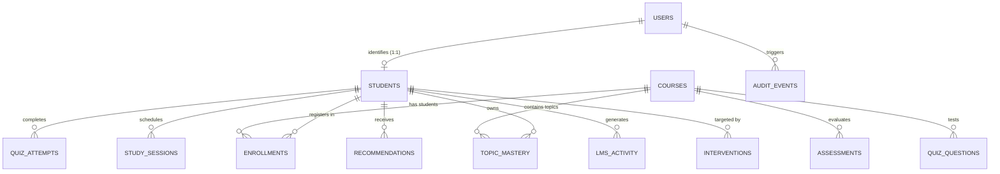

# CampusIQ — Relational Database Schema Architecture
**Database Engine:** SQLite (Local Dev) / PostgreSQL (Production)  
**ORM:** SQLAlchemy 2.0  
**Tables:** 14 Entities with full Relational Integrity

---

## 1. Entity-Relationship Overview

---

## 2. Table Specifications

### 1. `users`
System accounts, credential hashes, and role-based permissions.
* `id` (INTEGER, Primary Key, Auto-increment)
* `email` (VARCHAR(191), Unique, Indexed, Not Null)
* `hashed_password` (VARCHAR(255), Not Null) — PBKDF2-SHA256 salted hash
* `full_name` (VARCHAR(120), Not Null)
* `role` (VARCHAR(20), Not Null) — `'student'`, `'faculty'`, `'admin'`
* `is_active` (BOOLEAN, Default True)
* `created_at` (DATETIME, Server Default UTC)

### 2. `students`
Student academic profiles and longitudinal metrics.
* `id` (INTEGER, Primary Key, Auto-increment)
* `user_id` (INTEGER, ForeignKey(`users.id`), Unique, Indexed)
* `roll_number` (VARCHAR(30), Unique, Indexed, Not Null)
* `department` (VARCHAR(100), Not Null)
* `semester` (VARCHAR(30), Not Null)
* `cgpa` (FLOAT, Default 0.0) — Valid range [0.0, 4.0]
* `attendance_percent` (FLOAT, Default 0.0) — Valid range [0.0, 100.0]
* `avg_grade_percent` (FLOAT, Default 0.0) — Valid range [0.0, 100.0]
* `weekly_study_hours` (FLOAT, Default 0.0) — Normative 25.0 hrs/wk baseline
* `created_at` (DATETIME, Server Default UTC)

### 3. `courses`
Academic courses offered across terms.
* `id` (INTEGER, Primary Key, Auto-increment)
* `code` (VARCHAR(20), Unique, Indexed, Not Null) — e.g. `'MA-204'`
* `name` (VARCHAR(150), Not Null)
* `department` (VARCHAR(100), Not Null)
* `credits` (INTEGER, Default 3)
* `instructor_name` (VARCHAR(120))
* `term` (VARCHAR(30), Default `'Spring 2026'`)

### 4. `enrollments`
Course registration, current grade percentage, attendance, and credit status.
* `id` (INTEGER, Primary Key, Auto-increment)
* `student_id` (INTEGER, ForeignKey(`students.id`), Indexed, Not Null)
* `course_id` (INTEGER, ForeignKey(`courses.id`), Indexed, Not Null)
* `grade_percent` (FLOAT, Default 0.0)
* `attendance_percent` (FLOAT, Default 0.0)
* `assignments_completed` (INTEGER, Default 0)
* `total_assignments` (INTEGER, Default 0)
* `risk_category` (VARCHAR(20), Default `'Low'`)
* *Unique Constraint:* `(student_id, course_id)`

### 5. `assessments`
Graded exams, midterms, homework, and laboratory submissions.
* `id` (INTEGER, Primary Key, Auto-increment)
* `course_id` (INTEGER, ForeignKey(`courses.id`), Indexed, Not Null)
* `title` (VARCHAR(120), Not Null)
* `type` (VARCHAR(30), Not Null) — `'quiz'`, `'midterm'`, `'final'`, `'assignment'`
* `max_score` (FLOAT, Default 100.0)
* `weight_percent` (FLOAT, Default 10.0)
* `due_date` (DATETIME)

### 6. `topic_mastery` (Digital Learning Twin Records)
Continuous mastery telemetry at granular topic granularity.
* `id` (INTEGER, Primary Key, Auto-increment)
* `student_id` (INTEGER, ForeignKey(`students.id`), Indexed, Not Null)
* `course_id` (INTEGER, ForeignKey(`courses.id`), Indexed, Not Null)
* `topic_name` (VARCHAR(100), Indexed, Not Null)
* `mastery_score` (FLOAT, Default 0.0) — Valid range [0.0, 100.0]
* `status` (VARCHAR(30), Default `'priority learning gap'`)
* `attempts_count` (INTEGER, Default 0)
* `last_assessed_at` (DATETIME)
* *Unique Constraint:* `(student_id, course_id, topic_name)`

### 7. `quiz_questions`
Adaptive diagnostic item repository.
* `id` (INTEGER, Primary Key, Auto-increment)
* `course_id` (INTEGER, ForeignKey(`courses.id`), Indexed, Not Null)
* `topic_name` (VARCHAR(100), Indexed, Not Null)
* `difficulty` (VARCHAR(20), Default `'medium'`) — `'easy'`, `'medium'`, `'hard'`
* `question_text` (TEXT, Not Null)
* `options_json` (TEXT, Not Null) — Serialized JSON array of 4 choices
* `correct_answer` (VARCHAR(255), Not Null) — Kept confidential on backend
* `explanation` (TEXT, Not Null)

### 8. `quiz_attempts`
Student submission audits and scoring results.
* `id` (INTEGER, Primary Key, Auto-increment)
* `student_id` (INTEGER, ForeignKey(`students.id`), Indexed, Not Null)
* `course_id` (INTEGER, ForeignKey(`courses.id`), Indexed, Not Null)
* `topic_name` (VARCHAR(100), Not Null)
* `score_percent` (FLOAT, Not Null)
* `total_questions` (INTEGER, Not Null)
* `correct_count` (INTEGER, Not Null)
* `submitted_at` (DATETIME, Server Default UTC)

### 9. `study_sessions` (Rolling 7-Day Planner)
Scheduled study tasks and logged actual revision minutes.
* `id` (INTEGER, Primary Key, Auto-increment)
* `student_id` (INTEGER, ForeignKey(`students.id`), Indexed, Not Null)
* `task_name` (VARCHAR(200), Not Null)
* `topic_name` (VARCHAR(100))
* `planned_date` (DATETIME, Not Null)
* `planned_minutes` (INTEGER, Default 45)
* `actual_minutes` (INTEGER, Default 0)
* `priority` (VARCHAR(20), Default `'medium'`)
* `is_completed` (BOOLEAN, Default False)

### 10. `recommendations`
Personalized intervention actions generated by the recommendation engine.
* `id` (INTEGER, Primary Key, Auto-increment)
* `student_id` (INTEGER, ForeignKey(`students.id`), Indexed, Not Null)
* `title` (VARCHAR(150), Not Null)
* `description` (TEXT, Not Null)
* `category` (VARCHAR(40), Not Null) — `'academic'`, `'attendance'`, `'study'`
* `priority` (VARCHAR(20), Default `'medium'`) — `'low'`, `'medium'`, `'high'`, `'urgent'`
* `is_completed` (BOOLEAN, Default False)
* `created_at` (DATETIME, Server Default UTC)

### 11. `lms_activities`
56-day granular engagement telemetry.
* `id` (INTEGER, Primary Key, Auto-increment)
* `student_id` (INTEGER, ForeignKey(`students.id`), Indexed, Not Null)
* `activity_date` (DATETIME, Indexed, Not Null)
* `activity_type` (VARCHAR(50), Not Null) — `'lecture_attendance'`, `'quiz_submission'`, `'resource_access'`
* `hours_spent` (FLOAT, Default 1.0)
* `sessions_count` (INTEGER, Default 1)

### 12. `interventions`
Advisor-initiated remediation actions and tracking.
* `id` (INTEGER, Primary Key, Auto-increment)
* `student_id` (INTEGER, ForeignKey(`students.id`), Indexed, Not Null)
* `faculty_user_id` (INTEGER, ForeignKey(`users.id`), Indexed, Not Null)
* `intervention_type` (VARCHAR(50), Not Null) — `'Tutoring Referral'`, `'Advisor Check-in'`, `'Academic Counseling'`
* `severity` (VARCHAR(20), Default `'medium'`)
* `notes` (TEXT, Not Null)
* `status` (VARCHAR(20), Default `'Pending'`) — `'Pending'`, `'In Progress'`, `'Resolved'`
* `follow_up_date` (DATETIME)
* `created_at` (DATETIME, Server Default UTC)

### 13. `performance_histories`
Historical semester CGPA and credit trends for trajectory charts.
* `id` (INTEGER, Primary Key, Auto-increment)
* `student_id` (INTEGER, ForeignKey(`students.id`), Indexed, Not Null)
* `term_label` (VARCHAR(30), Not Null) — e.g. `'Fall 2024'`, `'Spring 2025'`
* `cgpa` (FLOAT, Not Null)
* `cohort_avg_cgpa` (FLOAT, Not Null)

### 14. `audit_events`
Security and administrative compliance ledger.
* `id` (INTEGER, Primary Key, Auto-increment)
* `user_id` (INTEGER, ForeignKey(`users.id`), Nullable)
* `action` (VARCHAR(100), Not Null) — e.g. `'CSV_IMPORT_COMMIT'`, `'INTERVENTION_CREATED'`
* `resource` (VARCHAR(100), Not Null)
* `details` (TEXT)
* `ip_address` (VARCHAR(45))
* `created_at` (DATETIME, Server Default UTC)

---

## 3. Database Migration Notes (SQLite vs. PostgreSQL)
- **Local Development**: CampusIQ uses SQLite with Foreign Key enforcement (`PRAGMA foreign_keys = ON;`).
- **PostgreSQL Ready**: Models use standard ANSI SQL datatypes and dialect-neutral SQLAlchemy schema definitions.
- **Data Persistence Guarantee**: `seed.py` is fully idempotent; running it multiple times performs safe lookups before insertions, ensuring no duplicate accounts, enrollments, or duplicate questions.
